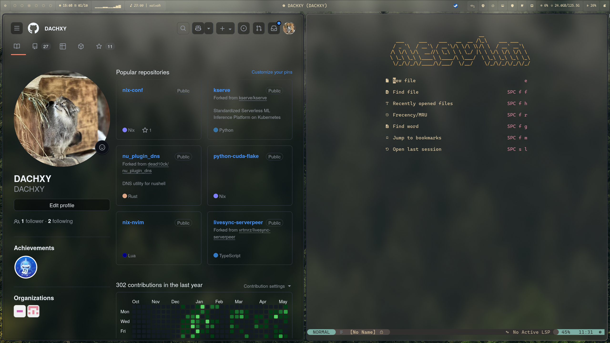

# 🚀 NixOS — Umbriel Desktop

A dendritic flake (`flake-parts` + `import-tree`, so every file under `modules/`
is a module by convention) that manages seven NixOS hosts and one Mac from a
single tree.

---

## 📷 Preview



## ✨ Main Applications

- [x] Umbriel (Wayland compositor — scrolling layout, blur, visual effects)
- [x] Noctalia Shell (bar, launcher, control center, OSD, notifications)
- [x] NVF (Neovim)
- [x] Zen Browser
- [x] Ghostty (Terminal)
- [x] Fish (shell)
- [x] Stylix

Niri is still wired in as a selectable session (`modules/niri.nix`), but the
desktop is Umbriel: `modules/umbriel.nix` holds the keybind/layout/window-rule
base, and per-user extras live in `modules/users/danny/umbriel.nix`.

## 🖥️ Hosts

| Host                         | Role                                     |
| ---------------------------- | ---------------------------------------- |
| `dn-workstation`, `dn-cscc`  | Desktops (NVIDIA)                        |
| `dn-notebook`                | Mac (nix-darwin)                         |
| `dn-server`, `dn-cc`         | Servers                                  |
| `dn-gcp`                     | GCP VM                                   |
| `generic`, `generic-desktop` | Base profile / installable desktop image |

Rebuild with the generated wrapper (it fills in the hostname for you):

```sh
rebuild          # nh os switch . -H "$(hostname)"
```

## 🎮 Game

- Steam
- Xbox wireless controller

## 🧠 Virtualization

- libvirt + virt-manager
- Incus, Podman

## ⌨️ Input (Fcitx5)

- Rime (bopomofo, pinyin)
- Mozc (Japanese)

## 🌐 VPN

- Netbird

## 🔐 Secrets

- sops-nix, with the hosts' SSH keys as age recipients
